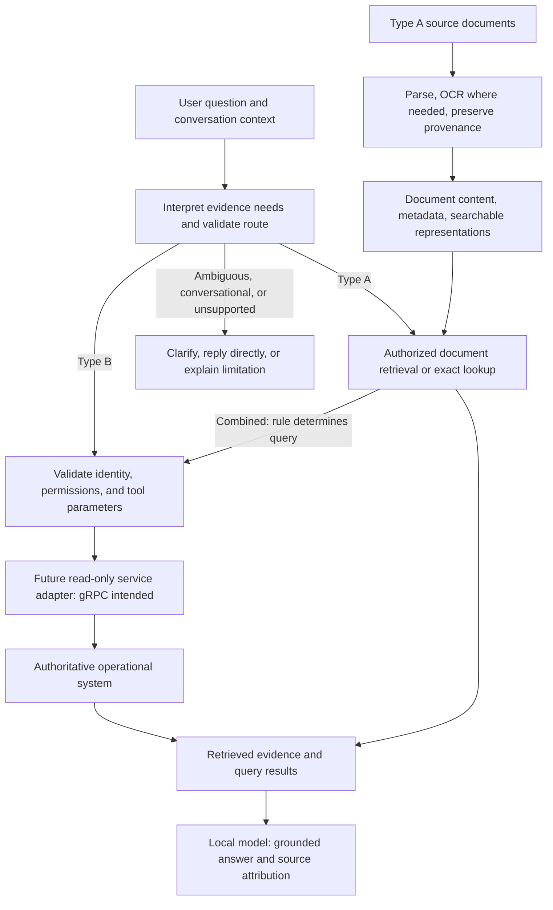

# Rita Bot Architecture

## Status and direction

This document distinguishes the implemented database foundation from the planned chatbot. Component names and routing outcomes describe responsibilities, not existing Python interfaces, endpoints, or schemas. See [README.md](README.md) for runnable commands and [AGENTS.md](AGENTS.md) for contributor instructions.

The current implementation uses Python 3.14, async SQLAlchemy and psycopg, PostgreSQL/pgvector, Alembic, and database tests. `python -m app.cli.check_db` checks connectivity and the vector extension. `index.py` is a thin compatibility wrapper for the same command; importing either entrypoint does not initiate a database check. The initial migration enables the extension without creating business tables. There is no chatbot/API framework, ingestion pipeline, model integration, or routing implementation.

The target is Python orchestration with locally operated models. No paid cloud inference service or RAGFlow dependency is required. Self-hosting pretrained models is distinct from training a language model from scratch; initial development should focus on retrieval and evaluation. Local operation still requires hardware, maintenance, and compliance with model licenses. All model-dependent stages, including OCR, embeddings, reranking, and generation, must be considered when keeping data local.

Command entrypoints live in `app/cli/`; database infrastructure remains in `app/db/`. Source documents stay in `assets/`, while future generated extraction results, caches, and reports belong under `data/` according to [its conventions](data/README.md). No ingestion pipeline or generated-data subdirectories are implemented yet.

## Data sources and retrieval strategy

| Category | Information | Intended retrieval |
| --- | --- | --- |
| Type A | Relatively stable policies, procedures, guides, forms, and reference data | Document retrieval with citations; exact lookup/computation for structured values |
| Type B | Current personnel, reporting relationships, project membership, and similar operational state | Defined read-only queries to authoritative systems |

Classification depends on meaning and freshness requirements, not file extension or storage location. An Excel policy table may need an exact row lookup. A CSV aggregate requires computation over the applicable records rather than counting retrieved chunks. An exported personnel file is not automatically authoritative for current assignments.

`assets/` is the existing source collection, not an implemented ingestion service. The current collection contains PDF, Word (`.doc`, `.docx`), and Excel (`.xlsx`) files. The Bravo ZIP package has been removed, and no archives remain in the current collection. Video files have been removed from the current source tree and remain available in Git history; video formats under `assets/` are ignored by Git. Candidate inputs also include CSV, JSON, Markdown, TXT, and structured objects; supported formats and extraction quality must be established during Type A implementation. Video transcription and archive processing are not assumed MVP capabilities.

## Target components and data flow

| Component | Responsibility |
| --- | --- |
| Ingestion | Parse approved formats, apply OCR when necessary, preserve structure, and prepare searchable content outside the interactive answer path |
| Document storage and metadata | Retain provenance, versions, effective dates, applicability, and access metadata alongside searchable representations |
| Retrieval | Combine semantic and keyword evidence where useful, apply access/applicability filters, and use exact structured-data operations when needed |
| Conversation context | Resolve follow-up references and topic continuity without treating prior model answers as authoritative evidence |
| Routing | Identify required evidence and propose document retrieval, business tools, both, clarification, direct replies, or unsupported handling |
| Business-data tools | Validate parameters and authorization, then call defined read-only operations through a future service adapter |
| Answer generation | Compose a natural response from evidence, attribute sources, and disclose missing or conflicting information |

### Target architecture — not implemented

### Type A: document evidence

Parse documents and use OCR for image-only content where required. Preserve headings, table relationships, page/section references, and applicability conditions rather than splitting away their meaning. Prepare searchable representations using the existing PostgreSQL/pgvector foundation where appropriate; exact storage and indexing details remain deferred.

Retrieve evidence relevant to the question and conversation context, then generate a cited answer. References should resolve to the source document and page/section or structured record as applicable. Updating or retiring a document must update its searchable representations so obsolete material is not silently used as current policy.

### Type B: current operational evidence

Resolve the authenticated user and required entity identifiers, validate parameters and permissions in the backend, and call a defined read-only function. Initial examples are retrieving a person's direct manager, active project memberships, or a project's responsible person. gRPC is the intended integration option; the external contract and authentication mechanism are not yet defined.

The model proposes a function and arguments; the backend controls execution. Arbitrary model-generated SQL is not the initial approach. A copied embedding index must not become the source of truth for current reporting relationships or assignments. Responses should identify the operational source and preserve relevant freshness information supplied by that source.

### Routing and combined questions

Use model interpretation together with deterministic backend checks. Supply descriptions of each source/tool's capabilities and required parameters. Consider conversation history and required evidence rather than keywords alone. Model-reported confidence is not sufficient proof that a route or answer is correct.

| Example | Intended behavior |
| --- | --- |
| “What is the leave application procedure?” | Retrieve Type A policy and cite it |
| “Who is my direct manager?” | Resolve authenticated identity and query Type B |
| “Under the procedure, whom should I send this form to?” | Find the approval role in A, then resolve the current person through B |
| “What about unpaid leave?” | Resolve the previous topic, then retrieve the relevant policy |
| “Who manages that project?” with no identifiable project | Ask for clarification before querying |
| “Hello” | Reply directly without business-data retrieval |
| A Type B request before integration exists | Explain that the operational source is not connected |

Combined retrieval may be sequential: first determine the approval rule, then query the person holding that role. Do not assume the direct manager is the approver unless the policy supports that relationship. No multi-agent architecture is required. After retrieval, check that evidence covers the question; otherwise clarify or state the limitation.

## Trust, freshness, and failure behavior

- Preserve document identity, versions, effective dates, applicability, and replacement/supplement relationships. A newer filename alone does not establish policy precedence.
- Apply access restrictions before source content reaches the model. Tool authorization belongs in the backend, not in model instructions alone.
- Resolve “me” from authenticated identity. A typed employee identifier does not grant access to that employee's information.
- Treat retrieved documents and tool outputs as evidence, not instructions that can override application behavior.
- Distinguish no matching evidence, disconnected sources, upstream errors, and access denial. Do not replace a failed Type B query with an answer based on stale documents.
- When sources conflict, explain the unresolved issue or ask for clarification instead of silently selecting a result. Absence of a retrieved policy is not proof that no policy exists.
- Keep citations tied to retrieved evidence. Conversation history supports interpretation but cannot establish business facts on its own.

## Delivery phases and evaluation

| Phase | Deliverable | Validation focus |
| --- | --- | --- |
| 0 — implemented | Database foundation and explicit migrations | Configuration, transaction lifecycle, connectivity, vector availability |
| 1 — planned | Type A MVP using an agreed document subset, retrieval, citations, and follow-up handling | Correct evidence, extraction quality, exact table answers, obsolete-document handling, unsupported B requests |
| 2 — planned | Authenticated, authorized Type B read-only tools | Identity/entity resolution, permission enforcement, freshness, unavailable services |
| 3 — planned | Combined A/B questions | Rule-to-person resolution, ordering of dependent calls, conflicting or incomplete evidence |

Use representative Vietnamese questions, paraphrases, follow-ups, ambiguous requests, and unanswerable questions. Measure retrieval quality and answer grounding separately, alongside latency and resource use. Phase 1 must not claim live personnel/project knowledge before Phase 2 exists.

Model selection, hardware sizing, API framework, exact schemas and module layout, chunking parameters, ranking configuration, authentication integration, gRPC contracts, and quantitative acceptance targets remain decisions for implementation planning. They are not commitments made by this document. Fine-tuning should follow a measured need rather than be an initial prerequisite.
